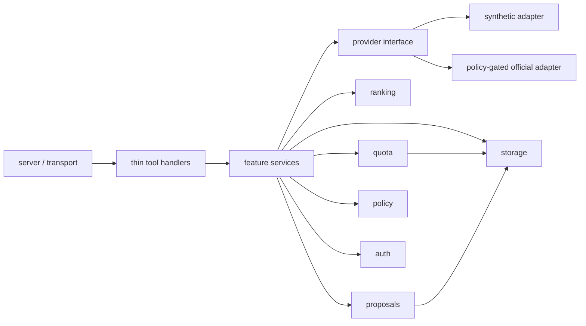

# MCP server module contracts

Design draft against SRS §§2–7. The nine purposes are baselined by IF-07–11. The snake_case wire names and field groupings below are proposed for implementation review.

## Layers and ownership

At ingress validate Origin and, in authenticated phases, the MCP access token. Bind the verified principal and diagnostic request ID to the call. Tool handlers validate schemas and route requests. Feature services coordinate policy, authorization, preflight and domain behavior. Only the provider interface reaches YouTube. Each tenant-owned storage access requires a principal predicate, including updates and deletes. Project-wide quota totals are explicitly shared. Enforce policy gates inside the server before protected computation or provider calls. IF-09a prohibits generic forwarding and bulk export.

## Proposed package tree and phase allocation

All paths below are children of src/yt_intel/. They describe intended ownership and boundaries.

| Package | Responsibility | First phase supported by available briefs |
|---|---|---|
| config/ | Validated settings and fail-closed live flag | 2, A |
| server/ | Streamable HTTP, Origin, context, health and auth integration point | 2, B |
| tools/ | Nine tool schemas and dispatch | 2, B, initially stubs |
| common/ | AppError, principal, UTC clock, request IDs, durations, canonical IDs and logging | 2, D |
| provider/ | Normalization, provider protocol, synthetic fixture implementation | 2, C |
| storage/ | Persistence, principal filters, WAL and transactions | 2, A |
| quota/ | Reservation, settlement, release, limits and Pacific-day accounting | 2, A |
| auth/ | Service identity, grant binding and Google authorization | 3, per Phase 2 auth handoff |
| ranking/ | Deterministic similarity and evidence for ranking | TBC — confirm with team |
| features/ | Search, recommendations and engagement orchestration | TBC — confirm with team |
| proposals/ | Immutable previews, approval, execution and reconciliation | TBC — confirm with team |
| policy/ | Capability-specific evidence and enforcement | TBC — confirm with team |

Phase 1 supplies documentation. Phase 2 supplies local foundations. Phase 3 introduces auth. Allocation across phases 4, 5, 6 and 7 is TBC — confirm with team; the seven-phase allocation table was absent from the reviewed materials.

## MCP tool catalogue

Return schema-defined JSON with diagnostic request ID. Include YouTube attribution and canonical links wherever a resource is displayed. Attach provenance to derived outputs. Each tool requires the authenticated MCP principal in the target service. Google authorization below refers to the separate delegated account grant.

| Proposed tool | Input and purpose | Structured result | Google authorization | Writes |
|---|---|---|---|---|
| similar_videos | Seed video URL or ID, bounded discovery | Ranked canonical videos, scores, factor explanations and coverage | Public reads only | None |
| similar_channels | Exact channel ID, handle or supported URL | Ranked channels, reasons or explained empty result | Public reads only | None |
| recommendations | Use linked account signals and bounded candidate set | Ranked videos, contributing signal sources and truncation | Read | None |
| engagement_analysis | Supported metric and period over account signals | Counts, units, coverage, time basis and comparisons | Read | None |
| propose_playlist | Topic, duration caps, language and visibility | Preview, ordered items, runtimes, channel, warnings, immutable reference | Read for account-bound preview | Local proposal only |
| confirm_execute_playlist | MRTR answer plus proposal-bound state | Outcome, operation reference, playlist link if known, per-item results | Write scope plus eligible channel | Approved playlist and item writes |
| operation_status | Principal-scoped operation reference | Status, reconciliation progress and per-item outcomes | No fresh grant for local status | None |
| disconnect | Connected account reference | Disconnect outcome and purge information | Existing grant if available for revocation | Revoke/unlink grant; no playlist change |
| delete_data | Principal-scoped deletion request | Receipt, purge deadline and external-content disclosure | No fresh grant for local deletion | Delete local account data |

Principal-scoped MCP resources are read-only. A confirmed playlist write requires both remote policy clearance and fresh authorization for the exact proposal.

## Provider boundary

The asynchronous contract batches video IDs, fetches channels, resolves exact channel references, runs bounded video search, lists liked videos, subscriptions, playlists and their items, and checks the caller’s own channel. Write methods create a playlist and insert an individual item. Reserve quota before access. Preserve page limits and unavailable IDs. Normalize durations to integer seconds or unknown; keep missing tags distinct from empty tags. Normalize timestamps to aware UTC while retaining their meaning. Map upstream errors once at this boundary using the [error model](error_model.md). Supply synthetic responses and deterministic faults through the fixture adapter. Never select the live adapter merely because credentials exist.

## Cross-cutting behavior

Validate non-secret configuration at startup. Keep raw credentials, user payloads and exception chains out of diagnostics. Correlate public errors and logs using the request ID. Use one canonical reference per entity for deduplication. Use UTC for stored instants and reporting; compute the quota-day label at midnight in America/Los_Angeles, including daylight-saving changes. See the [data model](data_model.md).

## Phase 2 changes · 25 November 2026

The [server skeleton](https://github.com/COolAlien35/youtube-video-intelligence-mcp/pull/14) mounts /mcp and exposes /health. Its outer request-ID middleware wraps Origin rejection, tool dispatch and HTTP errors. The factory refuses production startup before auth exists. Phase 3 replaces server.guards.get_principal; the SDK injects the principal without adding it to tool input schemas.

The [tool registry](https://github.com/COolAlien35/youtube-video-intelligence-mcp/pull/15) preserves all nine catalogue names. Each stub returns the same typed envelope with NOT_IMPLEMENTED. The SDK smoke tests exercise July discovery and legacy initialize separately. Neither flow invokes the provider. The frozen package dependency and real config integration await A. [SDK verification](https://github.com/COolAlien35/youtube-video-intelligence-mcp/pull/13)

## Phase 3 authentication and Google account linking · 28 November 2026

### Service identity on each MCP request

1. The outer ASGI middleware assigns a request ID. The Origin middleware checks any supplied Origin against the exact allow-list before bearer authentication. An untrusted Origin receives 403.
2. The service enforces HTTPS in production. A protected request needs a service bearer token. The verifier obtains public signing keys from the configured Supabase JWKS URL, caches them for ten minutes and limits refresh attempts to once per thirty seconds. It accepts ES256 and RS256, checks the signature, issuer, audience, expiry and any not-before claim, and requires a subject.
3. Authentication failures receive 401 with a Bearer challenge pointing to the public protected-resource metadata. Successful requests carry a Principal built from the verified issuer and subject. The MCP SDK resolves that principal for each tool invocation, including disconnect. Clients supply only tool arguments.
4. Health, protected-resource metadata, privacy and deletion instructions are public. Production HTTPS also applies to these endpoints. Deploy the service and its Google callback on the same public origin. Configure the reverse proxy to preserve the public host and supply the external scheme only through trusted proxy settings.

The pinned MCP SDK exposes a token verifier hook. An ASGI wrapper applies the same service identity checks to the mounted MCP transport and the Google authorization start route. Configure the project's exact issuer, audience and asymmetric JWKS endpoint before deployment. Supabase commonly issues user tokens with audience `authenticated`. Legacy shared-secret projects require a signing-key migration for this verifier. The deployment owner must confirm the actual project's signing mode and claims. [Supabase JWTs](https://supabase.com/docs/guides/auth/jwts) · [Supabase claims](https://supabase.com/docs/guides/auth/jwt-fields) · [MCP Python SDK authorization](https://py.sdk.modelcontextprotocol.io/run/authorization/)

### Delegated Google authorization

1. The authenticated browser starts at `/oauth/google/start`. The service binds the principal, random state and PKCE verifier to a five-minute attempt. A separate HttpOnly callback cookie identifies that browser. Google receives the S256 challenge, registered redirect URI, offline-access request and read scopes. Playlist writes remain gated.
2. On return, the callback checks the exact redirect URI, browser cookie, expiry and state, and consumes the attempt once. If the callback supplies a service bearer, its principal must match the original one. Without a bearer, the bound browser continuation identifies the original principal. A restart discards pending attempts. Deploy with one worker while this state is in memory.
3. The service exchanges the code and verifier, checks the scopes actually granted and obtains the Google subject with the access token. It encrypts the refresh token with the active AES-256-GCM key and principal-bound associated data. GrantRepo saves the ciphertext, nonce, key version and granted scopes under the service principal and Google account reference. An expired or revoked grant requires a fresh authorization. The offline fake covers the seven-day expiry applicable to Google testing-mode refresh tokens for these scopes. [Google web-server OAuth](https://developers.google.com/identity/protocols/oauth2/web-server)
4. The MCP tool `disconnect_google(account_ref)` loads only that caller's named grant, attempts revocation, then deletes the local grant and records the consent event. Its result reports whether Google confirmed revocation. The Phase 2 name `disconnect` calls the same handler.

The application access log records the URL path and request ID. Configure upstream access logs to omit callback query strings, which contain single-use codes and state. The public policy routes read the repository's privacy and deletion documents, so source deployments must include the docs directory.

The offline transport test links three accounts across two service principals in SQLite, denies a cross-principal disconnect and verifies that removing one grant preserves both unrelated grants. [JWT and middleware](https://github.com/COolAlien35/youtube-video-intelligence-mcp/pull/49) · [Google client](https://github.com/COolAlien35/youtube-video-intelligence-mcp/pull/51) · [Browser binding](https://github.com/COolAlien35/youtube-video-intelligence-mcp/pull/52) · [MCP disconnect and isolation test](https://github.com/COolAlien35/youtube-video-intelligence-mcp/pull/59)
